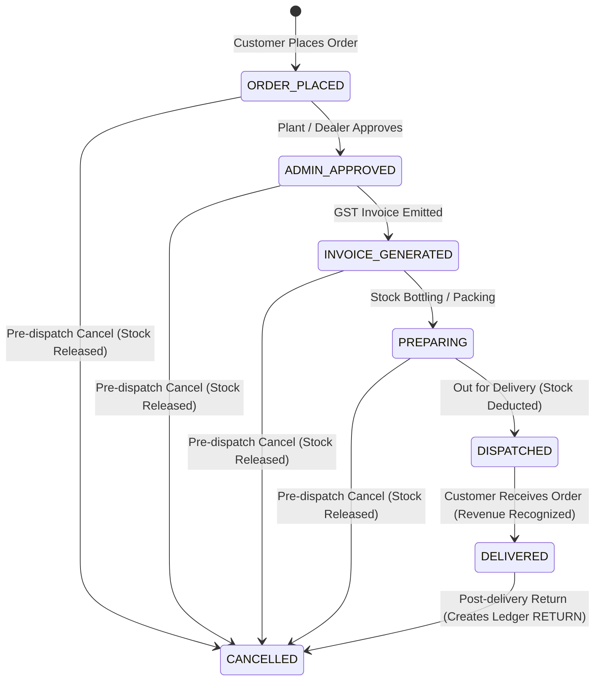
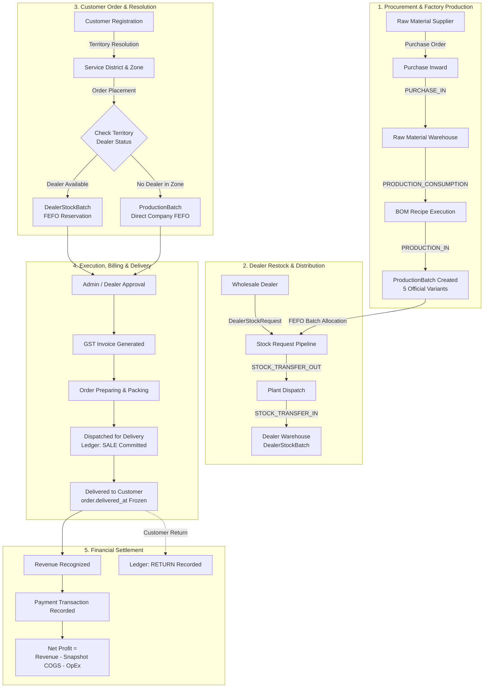

# Shivnath Agency — Enterprise ERP / CRM System
## Comprehensive User & Operational Manual

> **Document Version**: 2.0 (Authoritative Release)  
> **Application Title**: Shivnath Agency Pure Drinking Water Enterprise Platform  
> **Backend Architecture**: Django 5.x REST Framework / PostgreSQL (Hosted on Render Cloud)  
> **Frontend Architecture**: Flutter Multi-Role Client (Android / Web / Desktop)  
> **Live Production API**: `https://shivnath-agency.onrender.com/`  

---

## Table of Contents
1. [Official Product Catalog](#1-official-product-catalog)
2. [Order Lifecycle & State Machine](#2-order-lifecycle--state-machine)
3. [Dual Fulfillment Architecture](#3-dual-fulfillment-architecture)
4. [Dealer Onboarding & Territory Hierarchy](#4-dealer-onboarding--territory-hierarchy)
5. [CRM Lead Lifecycle & Scoring Engine](#5-crm-lead-lifecycle--scoring-engine)
6. [Automated 15-Day Nurturing Journey](#6-automated-15-day-nurturing-journey)
7. [Sales Executive Field Operations](#7-sales-executive-field-operations)
8. [Role-Based Live Authenticated Chatbot](#8-role-based-live-authenticated-chatbot)
9. [Billing, Credit & Financial Management](#9-billing-credit--financial-management)
10. [Support Desk & Omni-Channel Escalation](#10-support-desk--omni-channel-escalation)
11. [Inventory Ledger & 5-Tier Expiry Management](#11-inventory-ledger--5-tier-expiry-management)
12. [Customer Registration & Dual Validation](#12-customer-registration--dual-validation)
13. [End-to-End Enterprise Process Flow (Mermaid)](#13-end-to-end-enterprise-process-flow-mermaid)
14. [Implementation Fidelity & Gap Analysis](#14-implementation-fidelity--gap-analysis)

---

## 1. Official Product Catalog

Shivnath Agency operates on an authoritative product catalog containing **exactly five (5)** commercial packaged drinking water variants. All recipes, bills of materials (BOM), production batches, pricing tiers, and mobile order interfaces are standardized around these 5 products:

| # | Official Product Name | Packaging Type | Volume | Standard Case / Pack Size | Primary Use Case |
|---|------------------------|----------------|--------|---------------------------|------------------|
| 1 | **200 ML Bottle** | Virgin Food-Grade PET Bottle | 200 ml | 24 / 30 Units per Carton | Events, Conferences, Hospitality, Catering |
| 2 | **250 ML Bottle** | Virgin Food-Grade PET Bottle | 250 ml | 24 Units per Carton | Quick consumption, Meetings, Travel |
| 3 | **500 ML Bottle** | Virgin Food-Grade PET Bottle | 500 ml | 24 Units per Carton | Daily personal consumption, Retail, Gyms |
| 4 | **1 Litre Bottle** | Virgin Food-Grade PET Bottle | 1000 ml | 12 Units per Carton | Family dining, Travel, Corporate offices |
| 5 | **20 Litre Jar** | Heavy-Duty Food-Grade PC Jar | 20000 ml | 1 Unit (Returnable Can) | Residential homes, Commercial water dispensers |

> [!IMPORTANT]
> **Catalog Boundary**: 2 Litre and 5 Litre bottles are **not** part of the official catalog. Only the 5 products listed above are active in production and distribution.

---

## 2. Order Lifecycle & State Machine

Order processing in Shivnath Agency is governed by a strict, transactional state machine. Every status change triggers inventory reservations, accounting records, and an immutable entry in `OrderStatusHistory`.



### 2.1 Authoritative Status Transitions

1. **`ORDER_PLACED` (`order_placement`)**:
   - Order is created by the Customer via mobile app or phone order.
   - **Soft Stock Reservation**: System creates an `OrderItemBatchReservation` against eligible batches (FEFO). Quantity is soft-reserved (`reserved_quantity`), decreasing `available_quantity` without altering physical balances.
2. **`ADMIN_APPROVED` (`plant_approval`)**:
   - Admin or Dealer verifies delivery feasibility and confirms fulfillment.
   - Reservation is formally locked.
3. **`INVOICE_GENERATED` (`invoice_generated`)**:
   - Authoritative GST tax invoice is generated (`Invoice` model).
   - Base amounts, CGST, SGST, IGST, and Grand Total are locked into immutable snapshot fields.
4. **`PREPARING` (`preparing`)**:
   - Warehouse / plant staff pick and crate the physical batches.
5. **`DISPATCHED` (`dispatch`)**:
   - Order leaves facility aboard delivery vehicles.
   - **Physical Stock Deduction**: `OrderItemBatchReservation` is consumed; physical batch balance is deducted; an immutable `InventoryTransactionLedger` record of type **`SALE`** is committed atomically.
6. **`DELIVERED` (`delivered`)**:
   - Customer signs and receives delivery.
   - **Revenue Recognition Milestone**: `order.delivered_at` timestamp is frozen. Financial revenue is recognized in the general ledger.
7. **`CANCELLED` (`cancelled`)**:
   - **Pre-Dispatch**: Soft reservation is released (`released_quantity = reserved_quantity`). No physical inventory loss.
   - **Post-Delivery**: Handled as an authorized return. Triggers an `InventoryTransactionLedger` entry of type **`RETURN`** to bring sealed goods back into inventory.

### 2.2 Immutable OrderStatusHistory Audit Log
Every status update automatically records:
- `order_id`: Target order reference.
- `old_status` & `new_status`: Validated transition codes.
- `changed_by`: User ID of actor (Admin, Dealer, Customer, System).
- `notes`: Operational reason for state transition.
- `created_at`: Millisecond-accurate timestamp.

---

## 3. Dual Fulfillment Architecture

To prevent missed deliveries and maintain uninterrupted market presence, Shivnath Agency implements a dual fulfillment architecture:

```
                            [ Customer Order ]
                                    |
                    Is there an approved Wholesale Dealer
                        assigned to this Territory?
                                   / \
                            YES   /   \   NO
                                 /     \
    [ Dealer Fulfillment Flow ]         [ Direct Company Fulfillment Flow ]
    - Assigned Territory Dealer          - Shivnath Central Bottling Plant
    - DealerStockBatch (Local FEFO)      - ProductionBatch (Central FEFO)
    - Dealer Warehouse Dispatch          - Company Fleet Dispatch
    - Dealer Delivery & Margin           - Direct Company Revenue
```

### 3.1 Dealer Fulfillment (Primary Channel)
- Customer order is routed to the **primary Wholesale Dealer** assigned to the customer's territory zone.
- Soft reservations and dispatches consume from the dealer’s local warehouse (`DealerStockBatch`).
- Dealer earns contracted wholesale margins upon delivery.

### 3.2 Direct Company Fulfillment (Direct / Fallback Channel)
- Triggered if:
  1. The territory has no registered dealer yet (new growth zones).
  2. The assigned dealer is temporarily suspended or inactive.
  3. The customer explicitly requests direct enterprise supply.
- Dispatches execute directly from the **Shivnath Central Bottling Plant** using `ProductionBatch` records.
- **Fail-Safe Guarantee**: A customer is **never** blocked from ordering simply because no local dealer exists.

---

## 4. Dealer Onboarding & Territory Hierarchy

### 4.1 Dealer Lifecycle & Verification
Wholesale dealer applications undergo a compliance verification workflow. New registrations **never** auto-approve.

$$\text{PENDING} \longrightarrow \text{UNDER\_REVIEW} \longrightarrow \begin{cases} \text{APPROVED} \\ \text{REJECTED} \\ \text{SUSPENDED} \end{cases}$$

- **`PENDING`**: Initial submission by applicant (business name, contact, tentative district).
- **`UNDER_REVIEW`**: Compliance team reviews GSTIN, PAN, Aadhaar, warehouse premises, and security deposit.
- **`APPROVED`**: Admin assigns territory zone, generates unique Dealer Code (e.g. `DLR-PAT-001`), and activates wholesale ordering.
- **`REJECTED` / `SUSPENDED`**: Access blocked; prevents stock allocation or order dispatch.

### 4.2 Territory Hierarchy
Geography is structured into a four-tier relation:

$$\text{ServiceDistrict (District)} \longrightarrow \text{ServiceZone (Territory / Zone)} \longrightarrow \text{ServiceArea (Locality / Ward)} \longrightarrow \text{Delivery Address}$$

- **Pincode**: Stored at the `ServiceArea` level; **optional** during registration to prevent dropouts in newly developed or unmapped pin boundaries.
- **Territory Assignment**: Managed exclusively by Super Admin via `FranchiseTerritoryAssignment`.
- **Permanent Snapshot Integrity**: When a customer places an order, the system captures `snapshot_serving_dealer_id`, `snapshot_serving_dealer_name`, and `snapshot_territory`. If a dealer leaves or territory boundaries change later, existing historical orders retain their original fulfillment snapshot.

---

## 5. CRM Lead Lifecycle & Scoring Engine

Prospective franchise partners and bulk institutional clients are managed through an omnichannel CRM pipeline.

### 5.1 Canonical CRM Statuses (12 Tiers)
1. **`NEW`**: Inbound inquiry captured via public chatbot or web form.
2. **`CONTACTED`**: Initial phone screening completed by Sales Executive.
3. **`INTERESTED`**: Prospect has confirmed commercial interest in pure water distribution.
4. **`HOT_LEAD`**: High-intent prospect with available commercial space and capital.
5. **`FOLLOW_UP_REQUIRED`**: Prospect requested specific callback or information packet.
6. **`SITE_VISIT_SCHEDULED`**: Field inspection scheduled for proposed godown/outlet.
7. **`SITE_VISIT_COMPLETED`**: Physical site inspected by Sales Executive.
8. **`AGREEMENT_PENDING`**: KYC and partnership agreement shared for signing.
9. **`FRANCHISE_CONFIRMED`**: Security deposit received; legal agreement executed.
10. **`CONVERTED`**: Converted to active Wholesale Dealer in the ERP.
11. **`NOT_INTERESTED`**: Explicit rejection by lead.
12. **`LOST`**: Inactive, unresponsive, or dropped lead.

### 5.2 Deterministic Lead Scoring (Independent Metric)
Separately from the status lifecycle, every lead receives a dynamic score (0–100):
- **Base Verification** (20 pts): Valid name and mobile format.
- **Valid Email** (+15 pts): Corporate or active email provided.
- **Existing Business** (+20 pts): Proven retail or distribution track record.
- **Commercial Space** (+15 pts): Available godown or distribution shop.
- **Vehicle Access** (+15 pts): Delivery van or three-wheeler available.
- **Investment Budget** (+15 pts): Capital capacity matching franchise requirements.

**Score Tiers**:
- **`COLD` (0–44 pts)**: Low priority; automated SMS/WhatsApp nurture only.
- **`WARM` (45–74 pts)**: Moderate priority; standard follow-up queue.
- **`HOT` (75–100 pts)**: Immediate sales executive assignment and same-day calling.

---

## 6. Automated 15-Day Nurturing Journey

All new inbound leads enter a scheduled multi-touch WhatsApp nurturing journey managed by `LeadJourneyState`:

| Journey Cadence | Focus & Value Proposition | Message Content |
|-----------------|---------------------------|-----------------|
| **Day 1** | Welcome & Brand Assurance | Shivnath Agency purity promise, BIS/FSSAI certifications, digital corporate brochure. |
| **Day 3** | Commercial Viability | Profit margins per carton across 200ml, 250ml, 500ml, 1L, and 20L jars; ROI models. |
| **Day 5** | Social Proof & Quality | Manufacturing plant photo-tour, automated stainless-steel bottling lines, dealer testimonials. |
| **Day 7** | Plant Visit Invitation | Call-to-action to schedule an in-person plant tour and meet company leadership. |
| **Day 10** | Promotional Incentive | Limited-period initial stock incentive and marketing POS support kit. |
| **Day 15** | Closing Cadence | Final check-in; option to connect directly with executive or unsubscribe. |

### Automatic Pause & Stop Triggers
The automated journey immediately halts when:
- Status changes to **`CONVERTED`** (Active Dealer/Customer).
- Status changes to **`NOT_INTERESTED`** or **`LOST`**.
- Lead replies with **`STOP`** or **`UNSUBSCRIBE`** (opt-out compliance).
- Sales Executive initiates **`HUMAN_TAKEOVER`** to conduct direct discussions.

---

## 7. Sales Executive Field Operations

Sales Executives manage field relationships, dealer onboarding, and client inquiries within their assigned boundaries:

- **Lead Qualification**: Review inbound chatbot inquiries, analyze score, and verify preliminary interest.
- **Calling & Communications**: One-tap phone dialer and WhatsApp outreach with prefilled templates.
- **Meeting Logs & Notes**: Timestamped interaction logs (`CRMActivityLog`) tracking conversation history.
- **Follow-up Scheduling**: Calendar reminders with automated notification alerts for pending calls.
- **Site Visits**: Conduct physical inspections of proposed dealer godowns and retail counters.
- **Documents & KYC**: Upload applicant GST certificates, PAN cards, electricity bills, and signed agreements.
- **Territory-Scoped Security**: Enforced via server-side `apply_data_scope`. Executives can only access leads and customer orders within their designated districts and zones.

> [!NOTE]
> **Implementation Fidelity Note**:
> Automated real-time GPS hardware breadcrumbing and geofence verification for site visits are currently **NOT IMPLEMENTED / REQUIRES IMPLEMENTATION**. Site visits are presently recorded via structured manual visit logs, address fields, and verified notes in `FollowUp` and `CRMActivityLog`.

---

## 8. Role-Based Live Authenticated Chatbot

The in-app AI assistant dynamically adapts its menu and capabilities based on the authenticated user’s active role:

### 8.1 Customer Menu
- **Products**: View official 5 packaged water products.
- **Prices & Sizes**: Real-time retail prices (200ml, 250ml, 500ml, 1L, 20L Jar).
- **Product Availability**: Real-time stock status in customer's territory.
- **Compare Products**: Case sizes, bottle dimensions, and volume specs.
- **My Orders & Order Status**: Track live status of active delivery.
- **Payment / Billing**: Invoice download and UPI payment links.
- **Bulk Order Inquiry**: Route commercial banquet/event requests to sales.
- **Support Desk**: One-tap escalation to live customer support.

### 8.2 Wholesale Dealer Menu
- **Stock Balances**: View current warehouse inventory across the 5 variants.
- **Stock Request**: Submit restock request to Shivnath Central Plant.
- **Assigned Orders**: View and manage customer orders in territory.
- **Record Sales**: Log offline counter sales to retail shops.
- **Territory Customers**: Directory of registered customers in zone.
- **Dealer Info & Credit**: View credit limit, payment terms, and outstanding balance.
- **Reports**: Local sales volume and margin statements.
- **Operations Support**: Direct channel to plant logistics manager.

### 8.3 Operational Admin Menu
- **Leads & Pipeline**: Review new dealer inquiries and assign executives.
- **Orders Pipeline**: View orders across all lifecycle states.
- **Stock Requests**: Approve, partial-allocate, and dispatch dealer stock requests.
- **Production Batches**: Log newly completed bottling runs and inspection reports.
- **Inventory Balances**: Plant raw material and finished stock levels.
- **Follow-up Queue**: Today’s overdue and scheduled calls.
- **Notifications**: Low stock, credit breaches, and batch expiry alerts.

### 8.4 Super Admin Menu
- **Business Overview**: Real-time enterprise dashboard (Total orders, active dealers, active batches).
- **Revenue & P&L**: Delivered sales revenue, frozen BOM COGS, operational expenses, and net profit.
- **Dealer Network**: Global dealer credit health, territory assignments, and verification queue.
- **Batch Expiry**: Active 30/15/7/3-day expiry alerts across all facilities.
- **Enterprise Reports**: Daily aggregated business reports (`DailyBusinessReport`).

> [!IMPORTANT]
> **Data Integrity**: All chatbot responses are backed by live PostgreSQL queries (`Order.objects`, `ProductionBatch.objects`, etc.). The chatbot does not return mock or static business figures.

---

## 9. Billing, Credit & Financial Management

### 9.1 Authoritative Billing Workflow
```
[ Order Delivered / Stock Dispatched ]
                |
        [ Generate Invoice ]  <-- Authoritative source of truth
                |
    [ Dealer Credit Evaluation ]
                |
    +-----------+-----------+
    |                       |
[ Payment Received ]   [ Unpaid / Partial ]
    |                       |
[ PaymentTransaction ] [ Outstanding Balance Increases ]
    |                       |
[ Ledger Updated ]     [ Aging Report (0-30, 31-60, 61-90, 90+ days) ]
                            |
                       [ Overdue Reminder / Credit Block ]
```

### 9.2 Authoritative Financial Formula
Gross revenue and profitability are calculated from verified transaction events:

$$\text{Gross Revenue} = \sum \text{Grand Total of Orders reaching } \mathbf{DELIVERED}$$

$$\text{Gross Margin} = \text{Gross Revenue} - \text{COGS (Frozen Unit BOM Cost } \times \text{Units Delivered)}$$

$$\mathbf{Net\ Profit} = \text{Gross Margin} - \sum \text{Operating Expenses (Raw Materials, Electricity, Salaries, Fuel, Maintenance)}$$

### 9.3 Dealer Credit Profiles & Aging Reports
- **Credit Limit & Terms**: Every dealer has a configured credit limit (in INR) and terms (e.g. 7, 15, or 30 days).
- **Status Classification**:
  - `GOOD_STANDING`: Balance within limit, payments current.
  - `PAYMENT_DUE`: Invoices past agreed terms; automated warning sent.
  - `CREDIT_BLOCKED`: Outstanding balance exceeds limit or payments critically delayed; restock dispatches locked until payment recorded.
- **Aging Breakdown**: Invoices categorized into **0–30 days**, **31–60 days**, **61–90 days**, and **90+ days** for debt collection management.

---

## 10. Support Desk & Omni-Channel Escalation

The mobile client integrates a role-aware, database-driven Support Desk:

- **Database-Backed Contacts**: Support numbers and emails are retrieved dynamically from `SupportContact` records based on the user's role. **Zero hardcoded phone numbers** in source code.
- **Phone Call**: Direct dial via system intent (`tel:+91XXXXXXXXXX`).
- **Chat App Selection**: User chooses between WhatsApp or SMS.
- **Context-Aware Prefilled Message**:
  ```text
  Namaste, my name is Rahul Sharma.
  I am contacting Shivnath Agency Support regarding an enquiry.

  My details:
  Name: Rahul Sharma
  Mobile: 9876543210
  Role: Customer

  I would like to enquire about:
  Delivery delay for Order #ORD-1045
  ```
- **Strict User-Review Principle**: The application **never auto-sends** messages. It opens the user’s installed WhatsApp or SMS app with the text prefilled, requiring the user to explicitly tap send.
- **Graceful Fallbacks**: If WhatsApp or a dialer app is not installed, the app displays a copyable phone number and email dialog.

---

## 11. Inventory Ledger & 5-Tier Expiry Management

### 11.1 The 10 Authoritative Inventory Transaction Types
All stock modifications write an immutable row to `InventoryTransactionLedger`:

| # | Transaction Type | Category | Effect on Balance | Business Trigger |
|---|------------------|----------|-------------------|------------------|
| 1 | **`PURCHASE_IN`** | Raw Material | Increase (+) | Raw water, preforms, caps, labels received from supplier |
| 2 | **`PRODUCTION_CONSUMPTION`** | Raw Material | Decrease (-) | Raw materials consumed during a bottling batch run |
| 3 | **`PRODUCTION_IN`** | Finished Goods | Increase (+) | Finished bottles/jars manufactured and palletized |
| 4 | **`STOCK_TRANSFER_OUT`** | Finished Goods | Decrease (-) | Central plant dispatches stock to a wholesale dealer |
| 5 | **`STOCK_TRANSFER_IN`** | Finished Goods | Increase (+) | Dealer confirms receipt of stock at local godown |
| 6 | **`SALE`** | Finished Goods | Decrease (-) | Physical stock dispatched to retail customer |
| 7 | **`RETURN`** | Finished Goods | Increase (+) | Undamaged sealed stock returned and inspected |
| 8 | **`DAMAGE`** | Any | Decrease (-) | Bottles broken in transit, punctured jars, defect closures |
| 9 | **`EXPIRY`** | Finished Goods | Decrease (-) | Stock exceeding shelf-life; quarantined and disposed |
| 10 | **`ADJUSTMENT`** | Any | Positive / Negative | Formal inventory audit correction with admin sign-off |

### 11.2 FEFO Allocation Rule (First-Expired, First-Out)
- Stock reservation queries sort available batches strictly by:
  $$\text{ORDER BY } \mathbf{expiry\_date\ ASC}, \mathbf{manufacture\_date\ ASC}$$
- **Zero Allocation of Expired Goods**: Any batch where `current_date >= expiry_date` is mathematically barred from allocation.

### 11.3 5-Tier Expiry Monitoring & Deduplication
Automated cron jobs evaluate all finished batches daily across 5 thresholds:
- **`30_DAYS`**: 30 days remaining; flagged for promotional clearance.
- **`15_DAYS`**: 15 days remaining; prioritized in wholesale transfers.
- **`7_DAYS`**: 7 days remaining; urgent dispatch priority.
- **`3_DAYS`**: 3 days remaining; high-risk alert to plant manager.
- **`0_DAYS_EXPIRED`**: Shelf life exceeded; batch auto-marked `EXPIRED`, quarantined, and removed from active pool.

**State-Based Hash Deduplication**:
To prevent duplicate notification spam, alerts compute a state hash:
$$\text{Deduplication Hash} = \text{SHA-256}\left(\mathbf{batch\_type} : \mathbf{batch\_id} : \mathbf{alert\_level}\right)$$
Because `report_date` is omitted from the hash, running the cron job daily generates exactly **one** alert per tier per batch.

---

## 12. Customer Registration & Dual Validation

Customer account creation is protected by synchronized validation on both the client (Flutter) and server (Django REST Framework):

- **Full Name**: Mandatory; must be between **2 and 30 characters** of valid text.
- **Mobile Number**: Mandatory; must be **exactly 10 digits** starting with **6, 7, 8, or 9** (`^[6-9]\d{9}$`). Indian country code prefix `+91` is automatically normalized.
- **Email Address**: Mandatory; validated for standard RFC format and enforced as globally unique.
- **District**: Mandatory selection from configured service districts (e.g. Raipur, Durg, Bilaspur, Rajnandgaon).
- **Territory / Zone**: Mandatory selection dynamically loaded from the selected district's master `ServiceZone` table.
- **Locality & Address**: Physical street address for delivery routing. Pincode is optional.

---

## 13. End-to-End Enterprise Process Flow (Mermaid)

The diagram below maps the complete commercial cycle from raw material procurement to end-consumer delivery and financial reconciliation:



---

## 14. Implementation Fidelity & Gap Analysis

To ensure complete transparency between design specifications and the production codebase, the following matrix details the verification status of every requirement:

| Feature / Business Requirement | Codebase Implementation Status | Authoritative Implementation Location |
|--------------------------------|-------------------------------|---------------------------------------|
| **5 Official Products** (200ml, 250ml, 500ml, 1L, 20L Jar) | **VERIFIED & IMPLEMENTED** | `products/models.py`, `Product` table |
| **Removal of 2L & 5L Variants** | **VERIFIED & ENFORCED** | Initial fixtures & product catalog cleaned |
| **Complete Order Lifecycle** (6 canonical states + Cancel) | **VERIFIED & IMPLEMENTED** | `orders/models.py`, `Order.STATUS_CHOICES` |
| **`OrderStatusHistory` Audit Log** | **VERIFIED & IMPLEMENTED** | `orders/models.py`, `OrderStatusHistory` |
| **Soft Stock Reservation** (`OrderItemBatchReservation`) | **VERIFIED & IMPLEMENTED** | `orders/models.py`, `inventory/services.py` |
| **Physical Deduction at Dispatch** (`SALE` Ledger) | **VERIFIED & IMPLEMENTED** | `inventory/services.py`, `dispatch_order_atomic` |
| **Pre-Dispatch Stock Release on Cancellation** | **VERIFIED & IMPLEMENTED** | `inventory/services.py`, `cancel_order_atomic` |
| **Post-Delivery Restock** (`RETURN` Ledger) | **VERIFIED & IMPLEMENTED** | `inventory/services.py`, `cancel_order_atomic` |
| **Revenue Recognition at `DELIVERED`** | **VERIFIED & IMPLEMENTED** | `orders/models.py`, `order.delivered_at` |
| **Dual Fulfillment** (Dealer + Direct Company) | **VERIFIED & IMPLEMENTED** | `orders/models.py`, `ORDER_SOURCE_CHOICES` |
| **Dealer Onboarding** (`PENDING` $\to$ `APPROVED`) | **VERIFIED & IMPLEMENTED** | `accounts/models.py`, `FranchiseProfile` |
| **Territory Hierarchy** (District $\to$ Zone $\to$ Area) | **VERIFIED & IMPLEMENTED** | `accounts/models.py`, `ServiceDistrict`/`ServiceZone` |
| **Permanent Order Serving Dealer Snapshot** | **VERIFIED & IMPLEMENTED** | `orders/models.py`, `snapshot_serving_dealer_id` |
| **12 Canonical CRM Statuses** | **VERIFIED & IMPLEMENTED** | `leads/models.py`, `Lead.STATUS_CHOICES` |
| **Independent Lead Scoring** (Cold / Warm / Hot) | **VERIFIED & IMPLEMENTED** | `leads/models.py`, `calculate_lead_score` |
| **15-Day Automated Nurture Journey** | **VERIFIED & IMPLEMENTED** | `leads/models.py`, `LeadJourneyState` |
| **Automated Journey Pause Triggers** | **VERIFIED & IMPLEMENTED** | `leads/models.py`, `Lead.save()` pause logic |
| **Sales Executive Territory-Scoped Access** | **VERIFIED & IMPLEMENTED** | `accounts/services.py`, `apply_data_scope` |
| **Sales Executive GPS Real-Time Geofence Tracking** | **NOT IMPLEMENTED / REQUIRES IMPLEMENTATION** | *Manual notes/address supported; GPS hardware live tracking not in DB/API* |
| **Role-Based Authenticated Chatbot Menus** | **VERIFIED & IMPLEMENTED** | `accounts/views.py`, `RoleBasedChatbotMenuView` |
| **Live DB-Backed Chatbot Actions** | **VERIFIED & IMPLEMENTED** | `accounts/views.py`, `RoleBasedChatbotActionView` |
| **Billing & Dealer Credit Profiles** | **VERIFIED & IMPLEMENTED** | `billing/models.py`, `DealerCreditProfile` |
| **Dealer Aging Reports** (0-30, 31-60, 61-90, 90+) | **VERIFIED & IMPLEMENTED** | `billing/services.py`, `get_dealer_aging_report` |
| **Financial Formula** (Revenue - COGS - OpEx = Profit) | **VERIFIED & IMPLEMENTED** | `inventory/models.py`, `DailyBusinessReport` |
| **Database-Driven Support Desk** (No Hardcoded Phone) | **VERIFIED & IMPLEMENTED** | `accounts/models.py`, `SupportContact` |
| **Support Intent with User Review** (Never Auto-Send) | **VERIFIED & IMPLEMENTED** | `shivnath_agency/lib/core/services/support_desk_service.dart` |
| **5-Tier Expiry Alerting** (30, 15, 7, 3, 0 Days) | **VERIFIED & IMPLEMENTED** | `inventory/models.py`, `ExpiryAlertLog` |
| **Expiry State-Hash Deduplication** | **VERIFIED & IMPLEMENTED** | `inventory/models.py`, `ExpiryAlertLog.compute_hash` |
| **10 Inventory Ledger Transaction Types** | **VERIFIED & IMPLEMENTED** | `inventory/models.py`, `InventoryTransactionLedger` |
| **Dual Customer Registration Validation** (10-digit mobile) | **VERIFIED & IMPLEMENTED** | `accounts/serializers.py` & `customer_register_screen.dart` |

---

*Manual maintained by Shivnath Agency Engineering & Operations.*  
*For questions or updates, contact the enterprise engineering team.*
