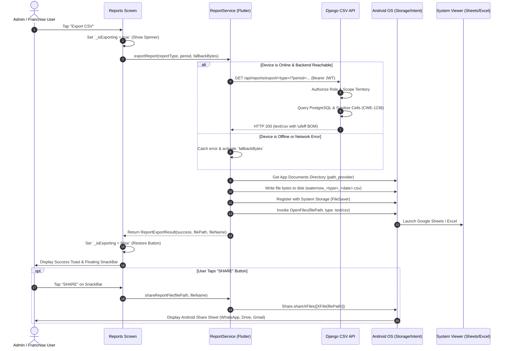

# WATERNow CSV Export: End-to-End Execution Flow

**Architecture**: Distributed Flutter Mobile App + Django REST Backend  
**Document**: Technical Workflow & User Experience Specification  
**Status**: VERIFIED & DEPLOYED  

---

## 1. High-Level Flow Architecture

The WATERNow CSV export architecture is a robust, multi-stage pipeline designed for resilience. If the mobile app is online, it pulls an authoritative, unpaginated dataset directly from PostgreSQL via the Django REST export endpoint. If the user is offline or traveling in remote areas with unstable network connectivity, the system seamlessly falls back to client-compiled CSV bytes, formats them with Microsoft Excel UTF-8 BOM, sanitizes cells, persists the file to local storage, triggers an auto-view intent, and presents a system Share Sheet.

---

## 2. Detailed Step-by-Step Flow

### Stage 1: User Initiation & UI Interlock
1. The Admin or Franchise user opens their Reports screen.
2. The user selects a time period (e.g. `Today`, `This Week`, `This Month`, or a `Custom Date Range`).
3. The user taps the **Export CSV** button in the AppBar.
4. **UI Interlock**: The button immediately swaps its icon for an active circular progress indicator (`_isExporting = true`). This prevents duplicate taps and re-entrant file writing while the operation is in flight.

### Stage 2: ReportService Delegation & Data Acquisition
1. The UI invokes `ReportService.exportReport(...)` passing:
   - `reportType`: The target catalog (e.g. `comprehensive`, `franchise_performance`, `orders`).
   - `period`: Active selected period filter.
   - `startDate` / `endDate`: Selected ISO date parameters.
   - `fallbackLocalBytes`: Pre-formatted client-side CSV bytes with `\ufeff` BOM.
2. `ReportService` queries `SessionService.getToken()` to retrieve the user's active Bearer JWT.
3. If an auth token exists, `ReportService` makes a secure HTTPS GET request to:
   `https://shivnath-agency.onrender.com/api/reports/export/<report_type>/?period=<period>&start_date=<start>&end_date=<end>`
4. **Backend Processing**:
   - The Django backend verifies JWT validity and checks user permissions.
   - For franchise accounts, queries are automatically filtered to include only orders and stock within their assigned territory.
   - Each cell value is processed through `sanitize_csv_cell()` to prevent formula injection.
   - The response stream is prefixed with the UTF-8 BOM (`\ufeff`) and returned with `Content-Type: text/csv; charset=utf-8`.

### Stage 3: Offline Resilience & Fallback Handling
1. If the network request fails due to `SocketException`, timeout, or HTTP error (e.g. while driving through areas without signal):
   - `ReportService` intercepts the exception gracefully without throwing an unhandled crash.
   - It seamlessly swaps the payload to `fallbackLocalBytes`.
   - The fallback bytes are generated directly from the in-memory data currently visible in the Flutter UI, also protected with `\ufeff` and formula sanitization.

### Stage 4: Storage Persistence & System Registration
1. `ReportService` resolves the application documents directory using `path_provider.getApplicationDocumentsDirectory()`.
2. A unique timestamped file is written to disk:
   `waternow_<reportType>_<YYYY>_<MM>_<DD>_<timestamp>.csv`
3. The file is also committed through `FileSaver.instance.saveFile` to register the file with the system download manager.
4. Verification confirms that the file exists on the filesystem and has non-zero byte size before proceeding.

### Stage 5: Document Viewing & System Share Sheet
1. `ReportService` calls `OpenFilex.open(filePath, type: 'text/csv')`. On Android, this triggers an `ACTION_VIEW` intent with `FLAG_GRANT_READ_URI_PERMISSION`.
2. The Android OS opens Google Sheets, Microsoft Excel, or WPS Office in the foreground.
3. Simultaneously, a floating `SnackBar` appears at the bottom of the screen:
   - Displays a confirmation: `Saved: waternow_<reportType>_2026_10_13.csv`.
   - Displays an action button: **SHARE**.
4. When the user taps **SHARE**, `share_plus` triggers the native Android Share Sheet (`Share.shareXFiles([XFile(filePath)])`), allowing the user to send the CSV to colleagues or accounting via WhatsApp, Gmail, Telegram, or Google Drive.
