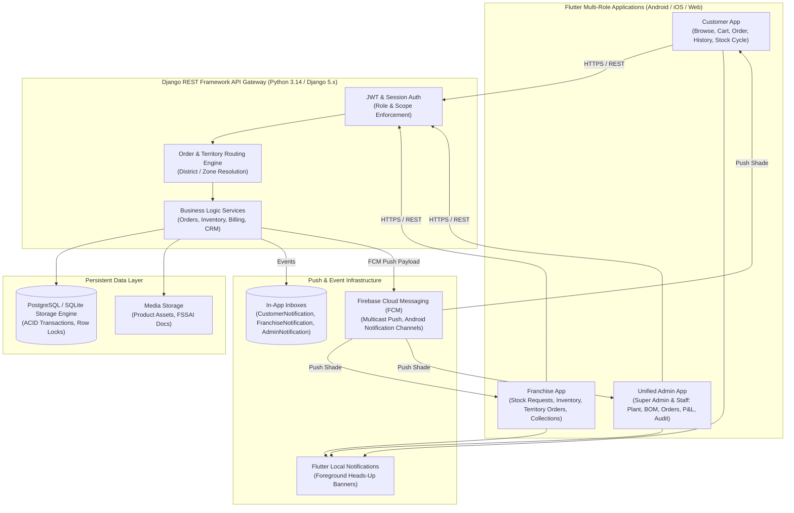
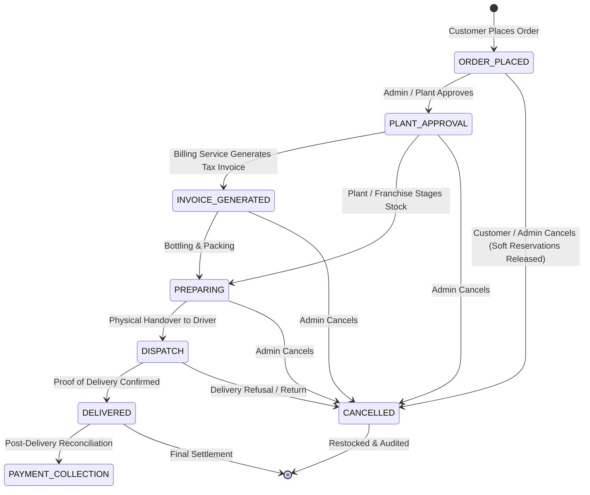
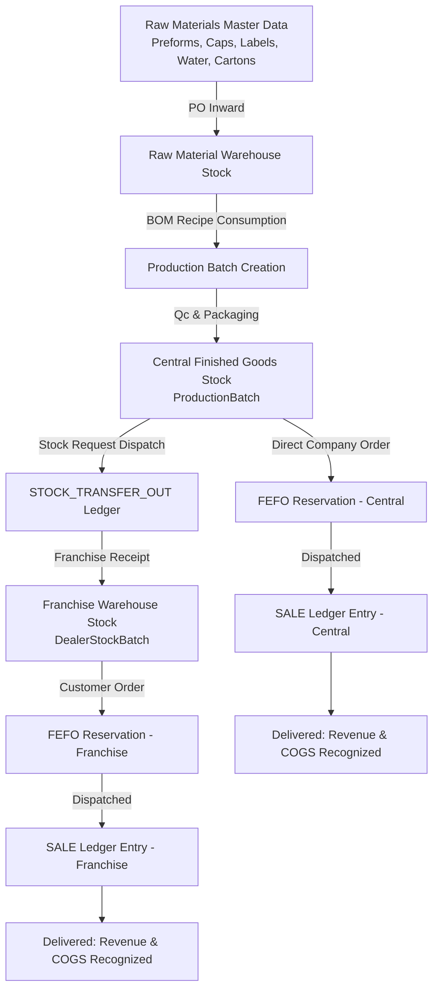
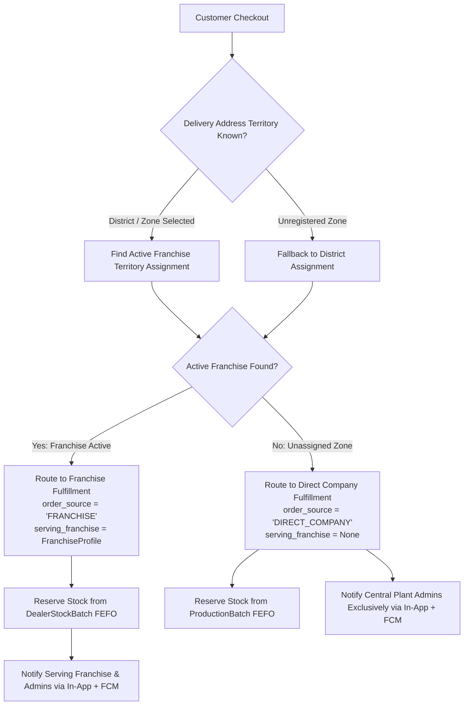
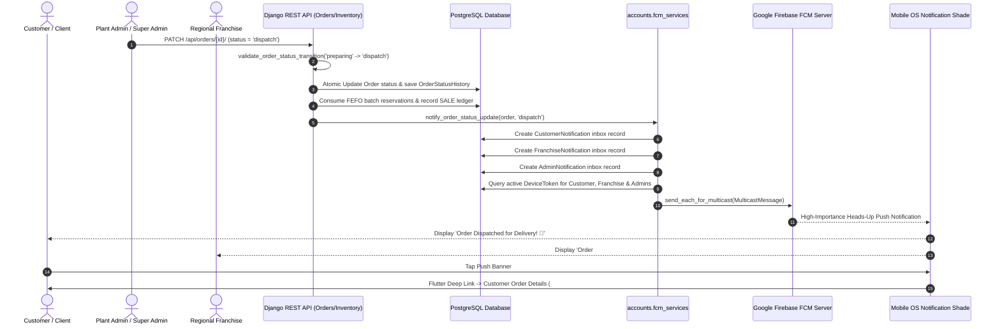

# WATERNow — Complete Business Flow & Technical Architecture

## 1. System Overview & Business Model

WaterNow (Shivnath Agency) operates an enterprise-grade, centralized packaged drinking water manufacturing and multi-tier distribution network in Chhattisgarh, India.

The operational hierarchy comprises:
1. **Central Bottling Plant & Corporate Headquarters**: Responsible for raw material procurement (preforms, caps, labels, shrink film), Bill of Materials (BOM) management, central batch production, finished goods inventory, central pricing, wholesale fulfillment to franchises, and direct company deliveries in uncovered regions.
2. **Authorized Regional Franchises (Dealers)**: Independent distribution centers assigned to specific territorial jurisdictions (Service Districts & Service Zones). Franchises purchase finished stock from the central plant via formal stock requests, maintain local warehouse inventory, and distribute/deliver water products to retail consumers and B2B clients in their assigned territories.
3. **Retail & Commercial Customers**: Individuals and businesses ordering 200ml, 250ml, 500ml, 1 Litre bottles, or 20 Litre water jars. Orders are intelligently routed either to the local serving franchise or directly to central plant dispatch if no active franchise covers the delivery zone.
4. **Sales Executives & Field Staff**: Field staff capturing inbound leads, performing site surveys, conducting client follow-ups, and managing lead journeys.

---

## 2. End-to-End System Architecture

---

## 3. Order Lifecycle & Status Progression

The order status machine enforces strict forward progression and immutable audit logging:

---

## 4. Central Manufacturing, BOM & Inventory Flow

---

## 5. Territory & Dynamic Order Routing

---

## 6. Real-Time Push Notification & Event Dispatch

---

## 7. Comparative Analysis: Intended Architecture vs Actual Implementation

| Architectural Layer | Intended Requirement | Actual Implementation | Verdict |
|:---|:---|:---|:---|
| **Role Authorization** | Customer, Franchise, Admin, Super Admin role separation with scoping | Enforced via `UserProfile.role`, `UserProfile.data_scope`, `IsAdminOrApprovedFranchise` | **PASS** |
| **Catalog Architecture** | 5 Official Initial SKUs with immutable IDs & packaging specs | 5 SKUs strictly enforced: `SHV-200`, `SHV-250`, `SHV-500`, `SHV-1L`, `SHV-20L` | **PASS** |
| **BOM & Manufacturing** | Recipe BOM consumption per batch; central stock separation | `ProductionRecipeBOM` models raw material consumption; `ProductionBatch` separates central stock | **PASS** |
| **Inventory Source of Truth**| Double-entry atomic ledger (`InventoryTransactionLedger`) | Every purchase, batch, transfer, sale, return, adjustment creates atomic ledger entries | **PASS** |
| **Order Routing Engine** | Dynamic territory routing with direct-company fallback | Resolves Chhattisgarh 33 districts & 70 zones; routes to Franchise or Central Plant | **PASS** |
| **Stock Cycle Subscriptions**| Calendar month & day durations with 7-day low-stock alerts | `CustomerStockCycle` implements calendar math, pause/resume, and 7-day alert rules | **PASS** |
| **FCM Push Notifications** | Push delivered to Android notification shade on status updates | Firebase Admin SDK multicast implemented with Android channel & recipient isolation | **PASS (Backend/SDK)** / **BLOCKED (Physical Device)** |
| **Hostinger VPS Target** | Production Nginx + Gunicorn + PostgreSQL deployment | Code is container/VPS ready with systemd & Nginx configs documented; live Render deployed | **READY** |
