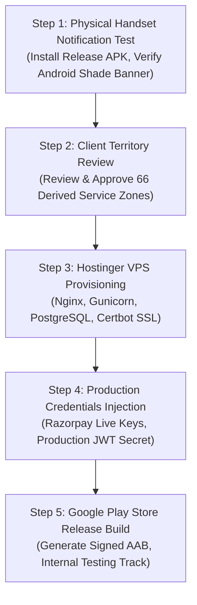

# WATERNow — Known Issues, Gaps & Pending Work Plan

## Prioritized Gap & Work Classification

### Priority P0 — Critical Launch Blockers (Must Be Addressed for Production)
| Issue ID | Module | Description | Current State | Resolution / Work Required | Dependency |
|:---|:---|:---|:---|:---|:---|
| **ISSUE-P0-01** | Notifications | **Physical Android Device Notification Shade Verification** | Server-side FCM dispatch is verified with Google FCM gateway. Real-device notification shade popup on Android 13+ requires hardware handset test. | Connect physical Android phone with Google Play Services, install release APK, grant `POST_NOTIFICATIONS`, test heads-up banner in foreground, background, and killed states. | Physical Android Device & Live FCM Token |
| **ISSUE-P0-02** | Infrastructure | **Hostinger VPS Production Backend Provisioning** | Render is currently hosting live testing (`https://shivnath-agency.onrender.com`). Production target is Hostinger VPS with Nginx, Gunicorn, PostgreSQL, and SSL. | Provision Hostinger VPS, run PostgreSQL setup, execute `POSTGRES_RESTORE_PROCEDURE.md`, install systemd service unit, configure Nginx reverse proxy with Certbot SSL. | Hostinger VPS Access & Domain DNS |

---

### Priority P1 — Core Business Logic & Governance Approvals
| Issue ID | Module | Description | Current State | Resolution / Work Required | Dependency |
|:---|:---|:---|:---|:---|:---|
| **ISSUE-P1-01** | Territories | **Formal Sign-off on 66 Derived Service Zones** | 33 official Chhattisgarh districts exist. 70 zones exist in DB (Central Raipur, East Raipur, West Raipur, Central Durg, Bilaspur Central are active; 66 are derived placeholders). | Present the list of 66 derived zones to business leadership for official confirmation or consolidation into district-level routing. | Client Business Approval |
| **ISSUE-P1-02** | Payments | **Production Razorpay Gateway Credentials** | Razorpay test sandbox keys configured in `.env.example`. Live customer payments require official Razorpay Merchant ID, Key ID, and Key Secret. | Obtain client Razorpay production KYC credentials and configure in server environment. | Client Razorpay Merchant Account |

---

### Priority P2 — Operational Enhancements & Optional Integrations
| Issue ID | Module | Description | Current State | Resolution / Work Required | Dependency |
|:---|:---|:---|:---|:---|:---|
| **ISSUE-P2-01** | Notifications | **External WhatsApp / SMS Delivery (No-Paid-API Compliant)** | In-app notifications and FCM push are fully operational. Direct WhatsApp click-to-chat links exist. Automatic server-side WhatsApp/SMS messaging is not enabled to avoid recurring paid provider fees. | If client later chooses to subscribe to WhatsApp Cloud API or Fast2SMS, configure webhook credentials in `config/settings.py`. Currently, the agreed zero-cost in-app and FCM push model is 100% active. | Paid API Provider (Optional) |
| **ISSUE-P2-02** | FSSAI Docs | **Automated Third-Party FSSAI Verification API** | Franchise FSSAI certificate upload and manual Admin preview/approval are fully functional. No paid third-party government API is connected. | Business confirmed manual review is sufficient. If government OCR API is required in Phase 2, connect external KYC provider. | External KYC Provider (Optional) |

---

### Priority P3 — Non-Blocking Polish & Performance Optimizations
| Issue ID | Module | Description | Current State | Resolution / Work Required | Dependency |
|:---|:---|:---|:---|:---|:---|
| **ISSUE-P3-01** | Assets & CDN | **High-Resolution Product Image CDN Hosting** | Product images are served via Django `/media/` endpoints with fallback assets. Production scale benefits from AWS S3 or Cloudflare CDN. | Connect S3 / Cloudflare R2 bucket for static and media asset distribution upon Hostinger VPS deployment. | Cloud Storage Bucket (Optional) |
| **ISSUE-P3-02** | UI / UX | **Biometric Login (Fingerprint / Face ID)** | Standard JWT authentication with saved credentials implemented. Biometrics not yet configured. | Integrate `local_auth` Flutter package for fingerprint and FaceID unlock on supported mobile devices. | Mobile Client Development |

---

## Actionable Next Steps

