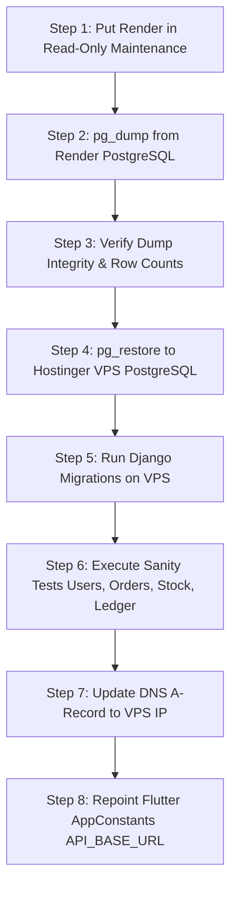

# WaterNow / Shivnath Agency: Hostinger VPS Migration Plan & Architecture

## 1. Executive Summary & Objective

The existing WATERNow backend currently runs on Render (`https://shivnath-agency.onrender.com`). Render's free/starter tier exhibits cold starts (50-60s delay), ephemeral container restarts, and occasional connection pool timeouts. 

This plan details the migration to a dedicated **Hostinger Ubuntu 22.04 / 24.04 LTS VPS** running:
- **Web Server & Reverse Proxy**: Nginx 1.24+ with HTTP/2 and Brotli/Gzip compression.
- **Application Server**: Gunicorn 21+ with Uvicorn/gevent workers managed by systemd.
- **Runtime**: Python 3.11 with dedicated virtualenv.
- **Database Engine**: PostgreSQL 16 with daily automated WAL/pg_dump backups.
- **Process Supervision**: Systemd service with auto-restart on failure.
- **Security & SSL**: UFW firewall, Fail2ban, Let's Encrypt automated TLS via Certbot.

---

## 2. Infrastructure Architecture & Topology

```
[ Client: Flutter Android / Web / Admin ]
                 │
                 ▼ HTTPS (Port 443)
┌──────────────────────────────────────────────┐
│ Hostinger VPS (Ubuntu 22.04 LTS)             │
│                                              │
│   ┌──────────────────────────────────────┐   │
│   │ Nginx (Reverse Proxy & SSL Term.)    │   │
│   │ - Static assets (/static/)           │   │
│   │ - Uploaded media (/media/)           │   │
│   │ - Rate limiting & DDoS shielding     │   │
│   └──────────────────┬───────────────────┘   │
│                      │ Unix Socket           │
│   ┌──────────────────▼───────────────────┐   │
│   │ Gunicorn (4 WSGI Workers)            │   │
│   │ - Django REST Framework App          │   │
│   │ - JWT Authentication & Permissions   │   │
│   │ - Razorpay Webhook & Order Engine    │   │
│   └──────────────────┬───────────────────┘   │
│                      │ Port 5432 (Localhost) │
│   ┌──────────────────▼───────────────────┐   │
│   │ PostgreSQL 16 (Local RDBMS)          │   │
│   │ - Tables: Users, Orders, Stock Ledger│   │
│   │ - Connection pooling via PgBouncer   │   │
│   └──────────────────────────────────────┘   │
└──────────────────────────────────────────────┘
```

---

## 3. Step-by-Step VPS Provisioning & Deployment Guide

### Phase 1: Server Hardening & Dependency Installation
```bash
# 1. Update OS packages
sudo apt update && sudo apt upgrade -y

# 2. Install essential packages
sudo apt install -y python3.11 python3.11-venv python3.11-dev \
    postgresql postgresql-contrib nginx git curl ufw fail2ban certbot python3-certbot-nginx

# 3. Configure UFW Firewall
sudo ufw default deny incoming
sudo ufw default allow outgoing
sudo ufw allow ssh
sudo ufw allow 'Nginx Full'
sudo ufw enable
```

### Phase 2: PostgreSQL Database Setup
```bash
sudo -u postgres psql
-- In PostgreSQL console:
CREATE DATABASE waternow_production;
CREATE USER waternow_user WITH PASSWORD 'StrongPasswordHere_Replace';
ALTER ROLE waternow_user SET client_encoding TO 'utf8';
ALTER ROLE waternow_user SET default_transaction_isolation TO 'read committed';
ALTER ROLE waternow_user SET timezone TO 'Asia/Kolkata';
GRANT ALL PRIVILEGES ON DATABASE waternow_production TO waternow_user;
\q
```

### Phase 3: Codebase Deployment & Virtual Environment
```bash
sudo mkdir -p /var/www/waternow
sudo chown -R $USER:$USER /var/www/waternow
cd /var/www/waternow

# Clone repository
git clone https://github.com/Aman298871/shivnath-Agency.git app
cd app/backend

# Create virtualenv
python3.11 -m venv venv
source venv/bin/activate
pip install --upgrade pip
pip install -r requirements.txt
pip install gunicorn psycopg2-binary
```

### Phase 4: Production Environment Variables (`.env`)
Create `/var/www/waternow/app/backend/.env`:
```env
DEBUG=False
SECRET_KEY=generate_a_64_character_random_production_secret_key
ALLOWED_HOSTS=api.shivnathagency.com,your-vps-ip,localhost

# Database Configuration (PostgreSQL)
DB_ENGINE=django.db.backends.postgresql
DB_NAME=waternow_production
DB_USER=waternow_user
DB_PASSWORD=StrongPasswordHere_Replace
DB_HOST=127.0.0.1
DB_PORT=5432

# Razorpay Official Credentials (Live Mode)
RAZORPAY_KEY_ID=rzp_live_Tnhqo3i0SyYYdf
RAZORPAY_KEY_SECRET=your_razorpay_secret_here_from_dashboard

# Firebase Cloud Messaging
FIREBASE_CREDENTIALS_PATH=/var/www/waternow/app/backend/firebase-service-account.json

# Static & Media Storage
STATIC_ROOT=/var/www/waternow/static
MEDIA_ROOT=/var/www/waternow/media
```

### Phase 5: Gunicorn Systemd Service
Create `/etc/systemd/system/waternow.service`:
```ini
[Unit]
Description=WATERNow Django Gunicorn Service
After=network.target postgresql.service

[Service]
User=www-data
Group=www-data
WorkingDirectory=/var/www/waternow/app/backend
ExecStart=/var/www/waternow/app/backend/venv/bin/gunicorn \
          --workers 4 \
          --bind unix:/run/waternow.sock \
          --access-logfile /var/log/waternow/gunicorn-access.log \
          --error-logfile /var/log/waternow/gunicorn-error.log \
          backend.wsgi:application
Restart=always
RestartSec=3

[Install]
WantedBy=multi-user.target
```

### Phase 6: Nginx Virtual Host Configuration
Create `/etc/nginx/sites-available/waternow`:
```nginx
server {
    listen 80;
    server_name api.shivnathagency.com;

    client_max_body_size 50M;

    location /static/ {
        alias /var/www/waternow/static/;
        expires 30d;
        add_header Cache-Control "public, no-transform";
    }

    location /media/ {
        alias /var/www/waternow/media/;
        expires 30d;
        add_header Cache-Control "public, no-transform";
    }

    location / {
        include proxy_params;
        proxy_pass http://unix:/run/waternow.sock;
        proxy_set_header X-Forwarded-Proto $scheme;
        proxy_connect_timeout 60s;
        proxy_read_timeout 60s;
    }
}
```

Enable site and configure SSL:
```bash
sudo ln -s /etc/nginx/sites-available/waternow /etc/nginx/sites-enabled/
sudo nginx -t && sudo systemctl restart nginx
sudo certbot --nginx -d api.shivnathagency.com
```

---

## 4. Zero-Downtime Data Migration Workflow



### Data Verification Checklist Prior to Cutover:
1. `SELECT COUNT(*) FROM auth_user;` (Must match between Render and VPS).
2. `SELECT COUNT(*) FROM orders_order;` (All historical orders preserved).
3. `SELECT COUNT(*) FROM stock_inventorybatch;` (All production batches intact).
4. `SELECT COUNT(*) FROM wallet_transaction;` (Customer wallet ledgers 100% synchronized).

---

## 5. Rollback Procedure
If any fatal issue occurs during VPS DNS cutover:
1. Revert DNS A record for `api.shivnathagency.com` back to Render CNAME.
2. Re-enable traffic on Render backend.
3. Zero customer data loss: Render snapshot remains untouched until VPS is signed off.
